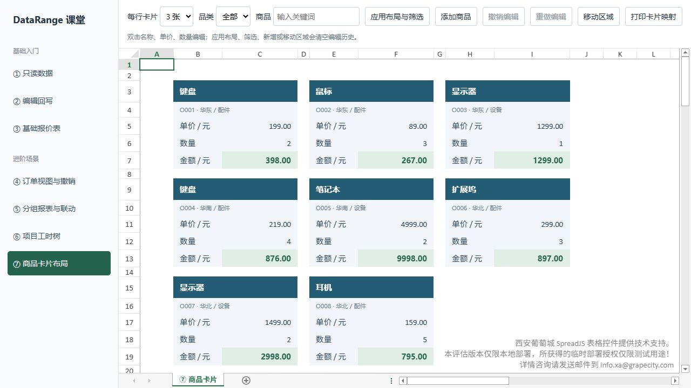

# 第七课卡片布局验证

日期：2026-11-23。Windows，Node.js，SpreadJS 19.2.3，Codex 内置浏览器，本机 5186 端口。

## 已验证

- 初始 8 条商品记录每行 3 张，最后一排 2 张；标题与元数据合并，卡片间距正常。
- 第二排第二张 O005 数量从 2 改为 4，金额 9998.00 → 19996.00，其他卡片保持原值。
- 页面原生撤销恢复数量 2 / 金额 9998.00，重做恢复 4 / 19996.00。
- 合并标题“笔记本”可编辑成“办公笔记本”，元数据仍显示 O005。
- 每行改为 2 张，O005 移到第三排第一张，名称、数量、金额保留；旧布局历史清空。
- 筛选设备后显示 O003、O005、O007；最后一排空位没有卡片值。
- 关键词“不存在”时显示空结果提示。
- 空结果状态新增商品 O009，因当前关键词不匹配，仍为空结果，Console 给出解释；改关键词为“新商品”后可见。
- 新商品品类沿用已应用的“设备”，数量 1、单价 100、金额 100.00。
- 移动区域后，卡片合并与内容保持正确；单价改为 125，金额随之变为 125.00。
- 数量输入 1.5 被忽略，保留数量 1，并在 Console 提示非负整数要求。
- 刷新后将 O001 数量改为 6，金额 1194.00；表格焦点下 Ctrl+Z 恢复 2 / 398.00，Ctrl+Y 恢复 6 / 1194.00。
- 最后刷新恢复初始数据，浏览器捕获的 error 级别日志为空。

## 自动检查

`node --test tests/business-model.test.mjs`：共 6 项测试通过，0 失败。其中新增的卡片测试检查：跨排定位、两列/三列映射、字段只读判断、间距、末排空位、零记录、越界坐标，以及根据卡片坐标写回 O005 而不改 O001。

`node --check public/07-cards.js` 通过。

## 边界

本次覆盖固定模板、少量本地数据和单格编辑；未进行批量粘贴、图片、自定义绘制、接口持久化、拖拽排序或大数据性能测试。布局切换、新增与移动前清空原生历史是本例的应用策略。第七课没有随窗口宽度自动调整卡片列数。

