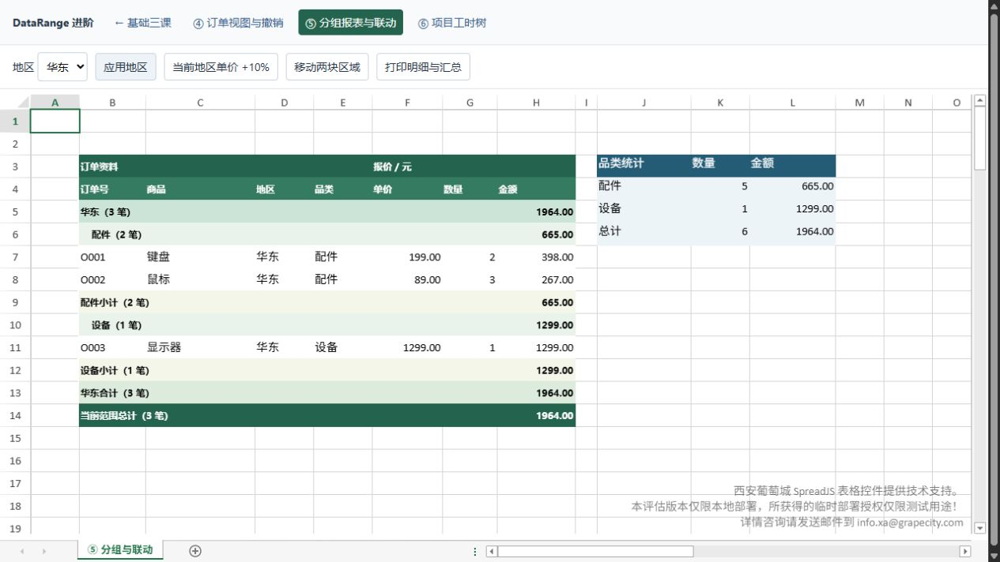
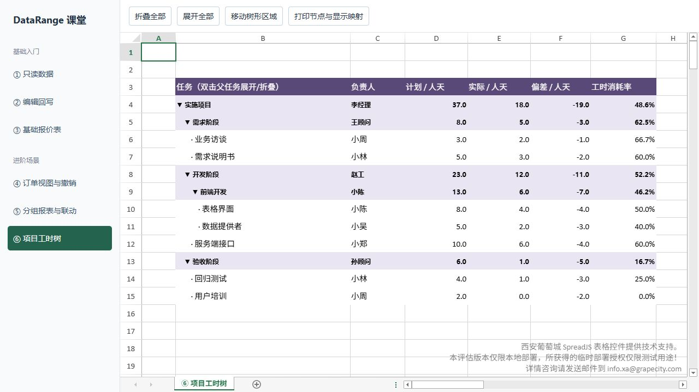

# DataRange 进阶：从订单视图到树形报表

完成本篇第四至六课后，可以继续 [第七课：卡片布局](./07-卡片布局教程.md)，把一条记录映射成多行、多列卡片，练习模板布局与正确回写。

你已经掌握 `getValue`、`setValue`、`getStyle`、`range`、`repaint`。这次把它们放到真实业务中：显示顺序会变，显示行可能是小计，某些数据行会因为折叠暂时消失。

学完这三个案例，你要能回答：**眼前这一行，到底对应哪条业务记录，还是根本不对应业务记录？**

## 运行与阅读顺序

继续使用原来的 `datarange-one-day` 项目，不需要安装新包。保留 SpreadJS 19.2.3，不升级依赖。

```powershell
npm start
```

默认入口为 http://localhost:5186/?step=4 。浏览器模块统一使用 `.js`；如果更新后仍看到旧模块名，请按 Ctrl+F5 强制刷新。也可以另开终端运行：

```powershell
$env:PORT='5187'
npm start
```

**本次已经运行的预览使用 5187。** 下表链接使用这个端口；自己启动时以终端显示的地址为准。

| 顺序 | 场景 | 核心源码 | 先解决的问题 |
| --- | --- | --- | --- |
| ④ | [订单视图与撤销](http://localhost:5187/?step=4) | `public/04-orders.js` | 排序筛选后，怎样改对记录？ |
| ⑤ | [分组报表与联动](http://localhost:5187/?step=5) | `public/05-groups.js` | 一块区域有多种行，怎样读写、合并和汇总？ |
| ⑥ | [项目工时树](http://localhost:5187/?step=6) | `public/06-tree.js` | 折叠隐藏了行，为什么汇总不能跟着减少？ |

每个场景单独初始化数据；切换场景或刷新会重置。按 F12 查看编辑日志、业务对象和显示行映射。先读场景里的 Provider，再阅读共享的 `public/business-model.js`，那里是纯 JavaScript 业务逻辑。

这三个案例都使用普通 Worksheet + 自定义 DataRange，没有引入 TableSheet、数据透视表或树表插件。

## 一、共同升级：增加“显示映射”这一层

基础例子中的关系很简单：

```text
区域第 1 行 → rows[0]
区域第 2 行 → rows[1]
```

但加入排序后，第一行可能变成 O005。加入分组后，第一行可能是“华东”，根本不是一条订单。加入树形后，一条任务可能暂时不在屏幕上。

所以现在的数据流变成：

```text
业务 records / nodes
        ↓ 筛选、排序、分组或树形遍历
显示行 visible / display
        ↓ getValue / getStyle / getSpans
DataRange

用户编辑 → 显示行 → 业务记录 ID 或对象 → 写回 → 重建显示行 → 调整尺寸并重绘
```

**DataRange 负责区域与提供者的连接；显示映射由我们自己的 JavaScript 代码管理。** 你会发现下面三个场景的 SpreadJS API 并没有突然变多，复杂度主要来自业务映射。

## 二、案例④：排序筛选与 DataRange 原生撤销、重做

本课按[官方“数据区域”文档](https://demo.grapecity.com.cn/spreadjs/help/docs/features/core-concept/worksheet/worksheet-data-range)实现 `setValue(..., changes)` 与 `undo(change)`，由 SpreadJS 维护历史栈。页面按钮和表格焦点下 Ctrl+Z / Ctrl+Y 使用同一套原生历史。

### 2.1 先做这个实验

1. 打开案例④，选择“金额从高到低”，点击“应用视图”。
2. 第一条应为 O005，“笔记本”，数量 2，金额 9998.00。
3. 把数量改为 0，按 Enter：该记录仍留在原行，金额变为 0，总金额变为 7530.00。
4. 点击“撤销编辑”：数量恢复 2，金额恢复 9998.00，总金额恢复 17528.00。
5. 点击“重做编辑”：数量再变为 0。
6. 点击一个表格数据格，使表格获得焦点，按 Ctrl+Z，再按 Ctrl+Y，应得到相同结果。
7. 撤销后，把单价改为 5000：这是一个新编辑，旧的重做分支应被清除。
8. 选择“华东”并应用视图：结果变为 3 条；撤销和重做记录清空。它们不再作用于旧布局。

注意：本课刻意保持编辑期间的显示行映射稳定。编辑只更新数值，不自动排序或把记录移出筛选结果。再次点击“应用视图”才重新计算筛选排序，并清空历史。这是本示例的应用设计边界，不是官方要求所有 DataRange 都必须清空历史。

### 2.2 显示数组和业务数组仍然分开

`orderView` 先 filter 再 sort：

```js
const visible = records.filter(item => /* 满足条件 */)
  .sort((a, b) => /* 比较金额，最后比较 ID */);
```

filter 产生新数组，sort 不改变原始 records 的顺序；visible 中的元素仍指向原业务对象。getValue 和 setValue 必须使用同一份 visible：

```js
const item = this.visible[row - 1];
```

减 1 是扣除表头。排序后不能改成 `records[row - 1]`，否则会写错记录。

### 2.3 第一步：启用工作簿撤销

```js
const spread = new S.Workbook(document.getElementById('ss'), {
  sheetCount: 1,
  allowUndo: true
});
const undoManager = spread.undoManager();
```

仅打开 allowUndo 不会让 SpreadJS 知道怎样恢复业务数组。提供者还需要记录 changes 并实现 undo。

### 2.4 第二步：setValue 中记录旧值

在实际代码完成边界检查、输入转换后：

```js
setValue(row, col, value, changes) {
  const item = this.visible[row - 1];
  // 实际代码先检查可写列并校验、转换输入，得到 field 和 next。
  if (Object.is(item[field], next)) return true;

  if (changes) {
    changes.push({
      type: 'value',
      id: item.id,
      field,
      oldValue: item[field]
    });
  }
  item[field] = next;
  queueMicrotask(refreshValues);
  return true;
}
```

这是说明流程的片段，完整可运行校验在 `04-orders.js`。`changes` 由 SpreadJS 传入，用于当前操作的变化记录；不要自己创建全局 changes 数组，也不再维护 past / future。

`oldValue` 必须在赋新值前取得。`type` 用于区分变化类型，`id + field` 用于恢复业务数据。官方二维数组例子保存 row / col；本课使用对象数组，因此在变化记录里保存业务身份。

调用方也可能直接调用提供者方法而不传 changes，所以先判断是否存在。直接修改 records 或直接调用 provider.setValue，不会自动生成原生编辑命令，不能据此认为一定有可撤销记录。学习时从表格界面提交编辑。

### 2.5 第三步：实现 provider.undo(change)

```js
undo(change) {
  if (change.type !== 'value') return;
  const item = byId.get(change.id);
  if (!item) return;
  item[change.field] = change.oldValue;
  queueMicrotask(refreshValues);
}
```

撤销时 SpreadJS 从当前命令取出变化记录，调用提供者的 undo。提供者负责恢复自己的数据，并更新派生金额和合计。这里直接恢复字段，没有再次创建变化记录。

官方示例在 undo 里调用不带 changes 的 setValue 恢复二维数组，也是同一个原则：恢复数据，不重复登记新历史。

### 2.6 重做怎么发生

本课不需要额外实现 `provider.redo`。对本例的单格编辑，原生重做会重放原编辑命令，重新进入 setValue，并记录下一次撤销需要的变化。

```text
用户编辑 → setValue(row, col, value, changes)
          → changes.push(旧值) → 写回业务对象
撤销     → provider.undo(change) → 恢复 oldValue
重做     → 重放原编辑命令 → 再次进入 setValue
```

F12 Console 可看到对应的 `setValue`、`provider.undo`、`setValue` 日志。点击“打印数据与映射”还可以看到 `getUndoStack()` 和 `getRedoStack()` 输出。

页面按钮只是原生管理器的入口：

```js
undoManager.undo();
undoManager.redo();
```

按钮可用状态来自 `canUndo()` / `canRedo()`，不是另一份自定义历史。

### 2.7 为什么编辑期间不能立即重排

changes 中保存 ID 能让 undo 找到业务对象，但这还不能保证重做：原生编辑命令仍包含单元格坐标。如果编辑后自动把 O005 移到末尾，原来的坐标可能指向 O007，重放原命令就可能写错记录。

本例采用明确的两阶段处理：

- 编辑、撤销、重做：只执行 refreshValues，更新金额、合计、重绘和按钮状态，保持 visible 不变。
- 应用视图：先 endEdit 提交当前输入，再 clear 清空旧坐标历史，然后重新筛选排序、调整区域尺寸。

```js
if (!sheet.endEdit()) return;
undoManager.clear();
refreshView();
```

这是为原生单元格历史设置的布局边界。若以后需要跨排序、跨筛选的连续撤销，就需要把视图变化也作为可撤销命令，或设计按稳定记录 ID 重放的自定义命令。那属于下一阶段，不能只在 changes 中保存 ID 就声称解决了全部问题。

### 2.8 小练习

- 在同一视图连续修改两条记录，连续撤销两次、重做两次，核对业务对象和合计。
- 筛选“键盘”后把一条名称改为“鼠标”：本次编辑期间它仍留在当前行，可以撤销；重新应用视图后才离开结果，并清空历史。
- 在 setValue 和 undo 中设置断点，观察 changes 中的自定义对象，以及重做时再次调用 setValue 的过程。
- 输入不存在的关键词并应用视图：只显示表头和 0 条记录的合计。

**过关标准：** 能解释 changes 由谁传入、旧值在哪里记录、undo 由谁调用、重做如何发生，以及为什么本例把视图重建作为清栈边界。

## 三、案例⑤：地区→品类分组、多级合并表头、两块区域联动

适合分组销售报表、预算明细、工程清单。这里你会同时遇到表头、分组标题、明细、小计、总计五类以上的显示行。

左侧是地区→品类分组明细；右侧是当前筛选范围的品类摘要。两块区域读取同一份订单数据，通过一次 `refreshReport()` 一起更新。



### 3.1 先做这个实验

刷新案例⑤恢复初始值，地区选“华东”，点击“应用地区”。应看到：

| 项目 | 初始金额 |
| --- | ---: |
| 配件小计 | 665.00 |
| 设备小计 | 1299.00 |
| 华东合计 / 当前范围总计 | 1964.00 |
| 右侧品类统计总计 | 1964.00 |

找到 O001，把数量从 2 改成 6。它的金额变为 1194.00，配件小计变为 1461.00，华东总计和右侧总计都变为 2760.00。

再点击“当前地区单价 +10%”，两侧总计应为 3036.00。最后点击“移动两块区域”，观察合并表头、分组行和摘要一起向下移动，内容保持不变。

### 3.2 显示行不再等于订单

`groupReport` 产生的是一份“显示行描述表”：

```js
[
  { kind: 'band' },
  { kind: 'header' },
  { kind: 'region', label: '华东', amount: 1964, /* ... */ },
  { kind: 'category', label: '配件', amount: 665, /* ... */ },
  { kind: 'data', item: /* O001 原对象 */ },
  { kind: 'data', item: /* O002 原对象 */ },
  { kind: 'subtotal', label: '配件小计', amount: 665, /* ... */ }
  // 其余组和总计……
]
```

只有 `kind === 'data'` 的行携带可写的业务对象。其余都是根据订单生成的展示行，不应塞回业务 records。

```js
const line = report.display[row];
if (line?.kind !== 'data') return true;
```

此时不能靠“减去两行表头”直接计算业务下标，因为表头后面还插入了各种分组标题、小计。最稳妥的做法是直接根据显示行描述，找到其中的 `item`。

### 3.3 合并属于提供者的 getSpans

第一行分成两个合并区域：

```js
new S.Range(0, 0, 1, 4) // “订单资料”：区域内第 0~3 列
new S.Range(0, 4, 1, 3) // “报价 / 元”：区域内第 4~6 列
```

分组标题和小计把前 6 列合并，金额保留在第 7 列。全部都是区域内部坐标，移动整个 DataRange 时，不需要重新加上工作表起点。

`getSpans` 收到本次查询范围，返回与它相交的合并：

```js
getSpans(row, col, rowCount, colCount) {
  return mergedRanges.filter(span => span.intersect(row, col, rowCount, colCount));
}
```

`mergedRanges` 只在报表重建时计算一次。不要在高频绘制回调里重新筛选全部记录、生成所有分组。

当分组数量改变，合并所在的行号也会改变。因此 `refreshReport` 既要重建显示行，也要重建合并列表。

### 3.4 两个 DataRange 怎样共享同一份业务数据

```js
sheet.dataRanges.add('group-report', provider, leftRange);
sheet.dataRanges.add('category-summary', summaryProvider, rightRange);
```

名称不同、范围不相交。主区域有自己的提供者，摘要区域有自己的提供者；它们都读取模块中的当前 report。

编辑左侧明细时：

1. 通过显示行描述找到订单对象，写回单价或数量。
2. 从业务 records 重建分组、品类汇总和当前范围总计。
3. 根据新行数调整两块 DataRange。
4. 分别 repaint。

这是一段明确的应用更新流程，并不是 DataRange 自动建立了跨区域依赖。只 repaint 左侧，右侧就可能保留旧画面；只改数组不重算 report，缓存的汇总也不会更新。

### 3.5 汇总不能重复计算小计

华东的分组标题和华东合计都显示 1964.00，两个数字表达同一批业务记录的汇总。**不要遍历 display 里的金额求总和。** 那会把明细、分组标题、小计、合计重复相加。

本例所有汇总都从原始订单子集计算：

```js
summarize(regionItems)
summarize(categoryItems)
summarize(filtered)
```

在“全部”范围，原始总金额为 17528.00；右侧“配件”3233.00，“设备”14295.00。选择地区后，两块区域同步改变统计口径。

### 3.6 写入权限要在两处明确

- `getStyle`：只有明细的单价、数量 `locked: false`，其他行列只读。
- `setValue`：再次检查 `line.kind` 与列号，防止程序或其他入口误写合成行。

真实系统还需服务端授权和校验。这里的工作表保护只是界面限制。

### 3.7 小练习

- 在右侧增加“订单笔数”列：复用 `count`，同时修改摘要列数、列宽与 getValue。
- 增加“地区平均订单金额”，从地区 records 子集计算，不要从 display 求平均。
- 给 category 行增加折叠开关，隐藏其明细时仍保留完整的品类小计。可参考下一课的 Set 与可见行构建。

**过关标准：** 你能定义显示行类型，并保证合成行只读；能说清楚“合并列表、汇总缓存、区域尺寸”分别在什么时候更新。

## 四、案例⑥：项目工时树、展开折叠和逐级汇总

适合项目计划、WBS、部门层级、BOM 的初步建模。示例使用 `id + parentId` 平面数组，展示最多四层任务。

开放叶子任务的负责人、计划人天、实际人天。父任务工时由后代叶子汇总，不直接编辑。



### 4.1 先做这个实验

1. 刷新案例⑥，根任务“实施项目”的计划为 37.0，实际为 18.0。
2. 双击“前端开发”的标题格，折叠“表格界面”和“数据提供者”。根任务汇总应保持 37.0 / 18.0。
3. 把“业务访谈”的实际从 2 改成 4。
4. 需求阶段实际变为 7.0，项目实际变为 20.0；“前端开发”仍处于折叠状态。
5. “业务访谈”计划 3、实际 4，偏差 +1，应标红；工时消耗率为 133.3%。
6. 点击“折叠全部”，只显示根任务，但它的 37.0 / 20.0 不能改变。
7. 点击“展开全部”，恢复显示所有节点；移动区域后再次尝试双击父任务。

工时消耗率 = 实际 / 计划，**不等于任务完成进度**。实际工时超过计划是有意义的，因此比例没有强行限制到 100%。

### 4.2 业务树仍然是平面数组

```js
{ id: 'B', parentId: 'P', title: '开发阶段' }
{ id: 'B1', parentId: 'B', title: '前端开发' }
{ id: 'B11', parentId: 'B1', title: '表格界面', plan: 8, actual: 4 }
```

先建立 `children` 映射：`父 ID → 子节点数组`。不要每画一个格子都遍历整个节点集合寻找孩子。

`treeProjection` 校验了重复 ID、缺失父节点、循环关系。这里约定根节点 `parentId` 必须明确为 `null`。从接口获取数据时，先把它规范化成同一种约定。

### 4.3 分成两次遍历

第一次 `rollup(node)` 计算所有节点的统计值：

```text
叶子：读取自己的 plan / actual
父节点：对子节点汇总结果求和
```

父节点没有另一份手写的 plan / actual，避免“父值 + 子值”重复计数。结果缓存在 totals Map。

第二次 `visit(node, depth)` 计算可见行：

```text
先加入当前节点
如果当前节点没有折叠，继续遍历孩子
否则跳过其后代的显示
```

**汇总遍历看全部业务节点，可见行遍历才看 collapsed。** 这样展开折叠只改变显示，不改变业务口径。

如果先删掉折叠节点的后代、再计算汇总，父任务就会“折叠一次变小一次”。这类错误在树形报表中很常见。

### 4.4 折叠状态保存节点 ID

```js
const collapsed = new Set(['B1']);
```

显示行可能因前面的任务折叠而不断变化，但 B1 的身份稳定。更新叶子后重新生成 tree 时，继续使用同一个 Set，就能保留其他节点的折叠状态。

`getValue` 用深度缩进和 `▶ / ▼` 标识显示结构；它并没有写出额外的“树形单元格类型”。

### 4.5 双击钩子怎样拦截父任务

```js
onDoubleClick(row, col) {
  const line = tree.visible[row - 1];
  if (!line?.branch || col !== 0) return false;
  // 切换 collapsed 中的 line.node.id
  queueMicrotask(refreshTree);
  return true;
}
```

`true` 表示这次交互已经处理，阻止后续默认双击动作。`false` 让默认行为继续，因此叶子负责人或工时格仍可进入编辑。这和 `setValue` 的 true/false 不是同一套业务含义，要分别查接口契约。

### 4.6 叶子编辑后的完整路径

```text
显示行 → line.node → 更新 plan / actual
        → 全树重新汇总
        → 按已有 collapsed 重建 visible
        → range 调整行数
        → repaint
```

节点较少时，整树重算更容易读懂和验证。进一步优化时，可以只重算被修改节点的祖先路径；但必须维护父子索引和缓存一致性，先证明业务正确再优化。

### 4.7 小练习

- 增加“仅展开到第二层”按钮：把深度达到阈值的父节点 ID 放入 collapsed。
- 增加“超支任务”摘要：从叶子数据计算，不把父节点的超支再累加一遍。
- 增加独立的 `completion` 字段，把“完成进度”与工时消耗率分开。
- 把 root、branch、leaf 的样式统一成一张规则表，减少 getStyle 中的条件分支。

**过关标准：** 能解释为什么折叠状态、汇总缓存、可见行是三种不同的数据，并能做到折叠后总计不变。

## 五、这次要建立的实现习惯

| 场合 | 做法 | 主要原因 |
| --- | --- | --- |
| 高频读取 `getValue` / `getStyle` | 读取准备好的显示映射和缓存 | 避免每个格子重复分组、递归或请求接口 |
| 同时修改布局和编辑内容 | 先结束编辑，提交后重建视图 | 避免旧编辑器持有已经改变的行映射 |
| 撤销、折叠、选中记录 | 使用稳定 ID | 显示行号会变化 |
| 汇总 | 从真实业务记录计算 | 避免小计、合计重复进入汇总 |
| 多区域共享数据 | 一次更新业务模型，再更新所有相关提供者 | 重绘不能代替缓存重算 |
| 布局增大 | 检查区域尺寸和工作表容量 | DataRange 不能显示在宿主边界之外 |

三个案例都没有用 `setArray` 把全部业务数据复制进普通单元格。DataRange 的值和样式由提供者读取；我们维护业务模型与显示映射。

## 六、验证方法与下一步作业

项目带有 `tests/business-model.test.mjs`，可以直接运行：

```powershell
node --test tests/business-model.test.mjs
```

五项纯业务测试覆盖排序后对象身份、分组汇总不重复、折叠不影响树汇总、非法树结构和数值边界。第四课原生撤销、重做通过浏览器实际编辑验证，见 `原生撤销重做验证.md`。浏览器验证另见 `进阶验证记录.md`，它验证实际的编辑、布局、合并与交互。

建议按 ④→⑤→⑥ 阅读，每个案例先照实验做一遍，再打开 Provider，对照显示映射定位数据，最后独立完成一个练习。

学完之后，可以做一个综合作业：**部门项目成本表**。

1. 业务数据为任务树，每个叶子有 `planHours`、`actualHours`、`hourlyRate`。
2. 叶子成本由工时 × 单价计算；父节点汇总所有后代叶子成本。
3. 左侧显示可折叠的任务树，右侧 DataRange 按负责人统计成本。
4. 允许筛选负责人，同时明确父任务的总计是“全部任务”还是“筛选结果”。
5. 用 changes + undo 接入原生编辑历史；先保持编辑期间布局稳定，在筛选、折叠切换时明确处理历史边界。跨布局历史作为进一步扩展。

这需要把本次三个案例的“稳定身份、显示映射、统一汇总、多个区域刷新”组合起来。建议先完成前 3 项，再加入筛选与撤销。

## 范围与参考

本次重点是 DataRange 的复杂数据结构展示与正确回写。示例使用少量本地数据，不包含后端持久化、多人协作、完整批量粘贴事务、原生插删行历史或 Excel 导入导出。金额使用 JavaScript 数字与两位舍入做教学展示；正式财务业务另定精度策略。

排序、分组和树遍历由本项目的业务代码实现，可以在 Node.js 中单独测试。第四课的编辑历史则使用 SpreadJS 原生 UndoManager 和 DataRange 提供者 changes / undo 钩子，需在实际表格中验证。

本次已使用 SpreadJS MCP 的 overview、search、fetch 核验 `IDataProvider`、`getSpans`、`onDoubleClick`、区域与坐标行为以及 `Worksheet.endEdit`。

- [IDataProvider 接口](https://demo.grapecity.com.cn/spreadjs/help/api/interfaces/GC.Spread.Sheets.DataRange.IDataProvider)
- [数据区域说明](https://demo.grapecity.com.cn/spreadjs/help/docs/features/core-concept/worksheet/worksheet-data-range)
- [DataRange API](https://demo.grapecity.com.cn/spreadjs/help/api/classes/GC.Spread.Sheets.DataRange.DataRange)
- [Worksheet API](https://demo.grapecity.com.cn/spreadjs/help/api/classes/GC.Spread.Sheets.Worksheet)
