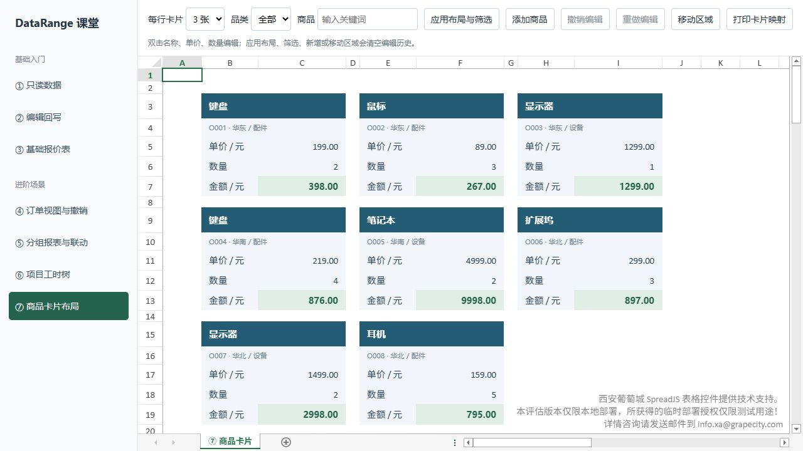

# 第七课：用 DataRange 实现可编辑的卡片布局

这一课把“每行一条记录”改为“每张卡片一条记录”。你会用已经熟悉的 DataRange 接口，完成二维卡片排布、合并标题、字段编辑、原生撤销重做和布局切换。

运行 `npm start`，在左侧“字段、单元格与卡片”中打开[第 07 课 多单元格卡片](http://localhost:5186/?step=7)。

核心代码是 `public/07-cards.js`；纯坐标映射函数 `cardCellAt` 放在 `public/business-model.js` 中，便于独立测试。数据仍在内存，刷新或切课会重置。



## 1. 先动手，再看代码

初始是每行 3 张卡片，共 8 条商品记录，因此最后一排只有 2 张。第一排依次是键盘、鼠标、显示器，第二排依次是键盘、笔记本、扩展坞。

每张卡片包含：商品名、订单编号与地区品类、单价、数量、金额。名称、单价、数量可编辑；编号等元数据、字段标签、金额与卡片间空白只读。

依次完成：

1. 找到第二排中间的笔记本 O005，把数量 2 改为 4。金额应从 9998.00 变成 19996.00。
2. 点击“撤销编辑”，再点击“重做编辑”，检查数量和金额一起恢复。
3. 双击它的蓝色标题，把“笔记本”改成“办公笔记本”。
4. “每行卡片”选择 2 张，点击“应用布局与筛选”。O005 应出现在第三排第一张，数量仍为 4、名称仍为“办公笔记本”。历史按钮清空。
5. 品类选“设备”，应用后只剩 O003、O005、O007；每行两张时最后一排只剩 1 张。
6. 商品关键词输入“不存在”，应用后显示空结果提示；清空关键词、品类恢复全部并应用，卡片重新出现。

控件修改后需要点击“应用布局与筛选”才生效。仅仅选择下拉框，不会立即改变正在编辑的坐标映射。

## 2. 先定义一张卡片的格子模板

本例没有创建一组 HTML 卡片。卡片直接位于 SpreadJS 的 Worksheet 中：DataRange 提供值、样式和合并区域。

一张卡片使用 5 行 × 2 列内容，右侧留 1 列间距，下方留 1 行间距。

| 卡片内部行 | 左列 localCol=0 | 右列 localCol=1 | 可编辑内容 |
| --- | --- | --- | --- |
| 0 | 商品名称，横跨两列 | 合并覆盖 | 名称 |
| 1 | 编号·地区/品类，横跨两列 | 合并覆盖 | 只读 |
| 2 | 单价 / 元 | price | 单价 |
| 3 | 数量 | qty | 数量 |
| 4 | 金额 / 元 | price × qty | 只读 |
| 5 | 下方空白间距 | 下方空白间距 | 只读 |

```js
export const CARD_ROWS = 6; // 5 行内容 + 1 行间距
export const CARD_COLS = 3; // 2 列内容 + 1 列间距
```

这里的 6 和 3 是卡片的排列步长，不是内容尺寸。相邻卡片的左上角相差 3 列，相邻排的卡片左上角相差 6 行。

## 3. 这次有三种坐标

| 坐标 | 作用 | 例子 |
| --- | --- | --- |
| 工作表坐标 | DataRange 放在工作表哪里 | 区域起点 `(2,1)`，即 B3 |
| 区域内部坐标 | Provider 接收到的 row / col | `(9,4)` |
| 卡片内部坐标 | 这张卡片里第几行、第几列 | `(3,1)`，数量值 |

SpreadJS 已经把工作表坐标转换为区域内部坐标，你只需要再做“区域 → 卡片”的转换。

假设每行 3 张卡片，Provider 收到 `(row=9, col=4)`：

```js
const cardRow = Math.floor(9 / 6); // 1：第二排
const cardCol = Math.floor(4 / 3); // 1：第二张
const index = cardRow * 3 + cardCol; // 4：visible[4]，即 O005
const localRow = 9 % 6; // 3：数量所在行
const localCol = 4 % 3; // 1：值所在列
```

因此，这个格子对应 `visible[4].qty`。如果区域起点是 B3，对应的工作表坐标是 `(11,5)`，即 F12。

**核心公式：**

```js
const index = Math.floor(row / CARD_ROWS) * perRow
            + Math.floor(col / CARD_COLS);
const localRow = row % CARD_ROWS;
const localCol = col % CARD_COLS;
```

`Math.floor` 决定是哪张卡片，取余 `%` 决定卡片内的哪个格子。

### 反向转换：业务下标 → 卡片起点

创建合并区域时，需要从业务记录 index 找卡片左上角：

```js
const row = Math.floor(index / perRow) * CARD_ROWS;
const col = (index % perRow) * CARD_COLS;
```

每行 3 张时，index=4 的卡片起点是 `(6,3)`；每行 2 张时，起点变成 `(12,0)`。业务对象没有变，只有展示位置变了。

## 4. 间距和最后一排空位不能误认成记录

定位 index 后还不能立即返回记录，需要检查：

```js
if (localRow === CARD_ROWS - 1 ||
    localCol === CARD_COLS - 1 ||
    index >= count) {
  return null;
}
```

分别排除：下方间距行、右侧间距列、最后一排不存在的卡片。完整函数还检查坐标边界。

例如每行 3 张、共 8 条记录时，最后一排右侧空位会算出 index=8，但最大合法下标是 7。若不检查，可能读取 undefined，或者把一次空白编辑写错到其他记录。

项目里的 `resolveCell` 在这个纯映射结果上附加业务对象：

```js
const cell = cardCellAt(row, col, perRow, visible.length);
return cell ? { ...cell, item: visible[cell.index] } : null;
```

getValue、getStyle 和 setValue 都复用它，避免读和写使用两套不同的坐标公式。

F12 Console 可以直接验证：

```js
demo.resolveCell(9, 4); // 默认每行3张：O005 的 qty
demo.resolveCell(5, 0); // null：下方间距
demo.resolveCell(0, 2); // null：右侧间距
demo.resolveCell(12, 6); // 初始8条、每行3张：null，最后一排空位
```

以上结果依赖当前已应用的布局和筛选条件。每行改为 2 张后，`(9,4)` 会对应另一条记录，不能仍然假定它是 O005。

## 5. getValue 决定卡片显示内容

取到 `{ item, localRow, localCol }` 后，按模板返回内容：

```js
if (localRow === 0) return localCol === 0 ? item.name : null;
if (localRow === 1) {
  return localCol === 0
    ? `${item.id} · ${item.region} / ${item.category}`
    : null;
}
if (localCol === 0) return { 2: '单价 / 元', 3: '数量', 4: '金额 / 元' }[localRow];
return localRow === 2 ? item.price
     : localRow === 3 ? item.qty
     : amount(item);
```

合并标题只在合并区域的左上角返回商品名，另一格返回 null。

空白间距同样返回 null。这里不返回 undefined，因为 undefined 会让 DataRange 继续尝试读取工作表本身的值。空白区域也是我们明确提供的内容。

金额是 JavaScript 派生值，继续使用之前的 `amount(item)`，不是电子表格公式。

## 6. getSpans 把格子连成卡片标题

每条业务记录产生两个合并：标题一行、元数据一行，各横跨两列。

```js
return [
  new S.Range(row, col, 1, 2),
  new S.Range(row + 1, col, 1, 2)
];
```

这些 row / col 是卡片在 DataRange 内部的起点。不能把工作表起点 `(2,1)` 再加进去，否则整体移动区域时合并就会错位。

所有合并列表在 `rebuildLayout` 中预先生成，getSpans 只筛选与当前查询范围相交的项：

```js
getSpans(row, col, rowCount, colCount) {
  return spans.filter(span => span.intersect(row, col, rowCount, colCount));
}
```

这是一个 DataRange 包含多张卡片，不是每张卡片都创建一个新的 DataRange。统一的映射使合并、编辑与布局切换更集中。

## 7. 编辑不能只根据列号判断字段

之前的列表里，第 5 列可能始终是单价。卡片布局中，同一列从上往下会分别出现名称、元数据、单价、数量、金额，所以下标必须同时看 localRow 和 localCol。

`cardCellAt` 返回可写字段 `field`：

| 条件 | field |
| --- | --- |
| localRow=0 的标题 | name |
| localRow=2 且 localCol=1 | price |
| localRow=3 且 localCol=1 | qty |
| 其他格子 | null |

标题是横向合并格，编辑由合并起点处理。元数据、标签、金额没有 field。

getStyle 用 `style.locked = !field` 配合工作表保护控制界面编辑；setValue 再次检查，防止其他写入路径误改标签或金额。

```js
const cell = resolveCell(row, col);
if (!cell?.field) return true;
```

然后验证输入并写回 `cell.item[cell.field]`。输入非法时保留原值并返回 true 消费请求，不能用 false 表示校验失败。数量必须为非负整数，单价必须为非负数，名称不能全为空白。

## 8. 原生撤销重做沿用第四课

赋值前记录旧值：

```js
if (changes) changes.push({
  type: 'value', id: item.id, field, oldValue: item[field]
});
item[field] = next;
queueMicrotask(refreshValues);
```

提供者恢复数据：

```js
undo(change) {
  if (change.type !== 'value') return;
  const item = byId.get(change.id);
  if (!item) return;
  item[change.field] = change.oldValue;
  queueMicrotask(refreshValues);
}
```

原生管理器通过按钮或表格焦点下 Ctrl+Z / Ctrl+Y 操作。同一布局内编辑不会自动重新筛选或排列；例如当前关键词是“笔记本”，改名后不再匹配时，也要等下一次应用筛选才离开结果。

以下操作会改变坐标映射或区域位置，因此本课在执行前先 endEdit，再清空原生历史：

- 改变每行卡片数、品类或关键词后应用。
- 新增商品后重建卡片。
- 移动整个 DataRange。

这是本教学案例选择的历史边界，避免原生重做重放旧坐标时写错对象。清空历史不会撤销已修改的数据；它只是让旧操作不能再撤销。

## 9. 调整区域尺寸与工作表布局

8 张卡片、每行 3 张，需要 `ceil(8/3)=3` 排。

```js
const rowCount = Math.max(1,
  Math.ceil(visible.length / perRow) * CARD_ROWS - 1);
const colCount = perRow * CARD_COLS - 1;
```

默认行数为 `3×6−1=17`，列数为 `3×3−1=8`。减 1 是去掉最末端多余的间距行和间距列，卡片之间的间距仍保留。

没有记录时，区域高度保留 1 行，合并这一行显示“没有符合条件的商品”，不创建 0 行区域。

值、样式、合并使用区域坐标；行高列宽属于工作表，设置时要加上 DataRange 的起点：

```js
sheet.setRowHeight(origin.row + row, height);
sheet.setColumnWidth(origin.col + col, width);
```

顺序是：

```text
结束编辑 → 清空旧历史
          → 按已应用条件生成 visible
          → 生成 spans
          → 确保工作表容量并设置行高列宽
          → 调整 dataRange.range
          → repaint 和更新按钮状态
```

“移动区域”在 B3 与 B5 之间切换。移动时仍使用相同的内部卡片坐标，只需为新位置设置宿主行高。行高列宽不是提供者的私有布局；工作表同一行、同一列中的其他区域也会受影响，多个不同布局并排时要提前规划。

## 10. 新增与筛选的关系

新增商品默认价格 100、数量 1、地区华东，品类沿用当前**已经应用**的品类，未筛选品类时使用配件。

关键词不自动清空。如果新商品不匹配关键词，它会存在业务数组中，但暂时不显示；控制台会解释原因。清空关键词并应用后可以看到它。

这与“点击添加却没有新增”的错误不同。先用“打印卡片映射”检查完整 records 和当前 visible，再判断问题来自数据还是筛选。

## 11. 阅读顺序与练习

建议先看 `cardCellAt`，手算两个坐标；再看 getValue / getSpans；接着看 setValue / undo，最后看 rebuildLayout。

| 练习 | 你需要修改什么 | 验收 |
| --- | --- | --- |
| 每张卡片增加库存 | 添加 stock 字段和模板行，更新行步长、映射、行高、getValue、校验 | 换行和末排空位仍正常 |
| 增加单排 1 张选项 | 下拉项；映射本来支持正整数 perRow | 8 条记录纵向排列且能编辑第 8 张 |
| 卡片顶部按品类配色 | getStyle 根据 item.category 选择色值 | 改变筛选后卡片颜色仍正确 |
| 金额达到 1000 时突出显示 | getStyle 的金额行读取 amount(item) | 修改数量后颜色跟着更新，撤销后恢复 |
| 加一个品类汇总区域 | 第二个 DataRange，独立区域、共享 records | 卡片编辑后重算并刷新摘要；注意区域不能相交 |

先独立完成一个练习，再增加其他功能。不要一开始就把尺寸、字段、样式都抽象成复杂的配置引擎；先掌握固定模板的映射。

### 自测题

1. 每行 3 张时，区域 `(9,4)` 对应哪条记录、哪个字段？
2. 为什么 `(5,0)` 和 `(0,2)` 都没有对应记录？
3. 每行改成 2 张后，为什么 index=4 的起点从 `(6,3)` 变成 `(12,0)`？
4. 为什么设置行高要加工作表起点，而 getSpans 不加？
5. 为什么单价改完只 repaint，而切换列数必须重建 spans 和 range？
6. changes 保存了 ID，为什么本例切换布局仍要清空原生历史？

答案都能讲清楚，就掌握了把其他固定模板重复排列成卡片的核心方法。员工档案卡、设备信息卡、巡检记录卡都可以沿用这一思路。

## 12. 验证与范围

运行 `node --test tests/business-model.test.mjs`。新增的卡片映射测试覆盖跨排定位、两列/三列转换、只读格、间距、末排空位、零记录和写回 O005。加上原有业务测试，目前共 6 项。

在浏览器中，可编辑一张卡片的单价并试一次撤销、重做，再将每行三张切换为每行两张，核对卡片重新排列后仍属于原来的记录。

本课是固定尺寸卡片模板。两列/三列由用户手动切换，不随窗口宽度自动计算；窗口较窄时可横向滚动。没有拖拽排序、图片上传、接口存储、分页或跨布局历史。金额沿用教学用 JavaScript 数字舍入，正式财务业务需另定精度策略。

MCP 已核验 `IDataProvider.getValue/getStyle/getSpans/setValue/undo` 的接口契约；卡片模板与坐标映射是本项目的业务实现。

- [官方数据区域文档](https://demo.grapecity.com.cn/spreadjs/help/docs/features/core-concept/worksheet/worksheet-data-range)
- [IDataProvider 接口](https://demo.grapecity.com.cn/spreadjs/help/api/interfaces/GC.Spread.Sheets.DataRange.IDataProvider)
