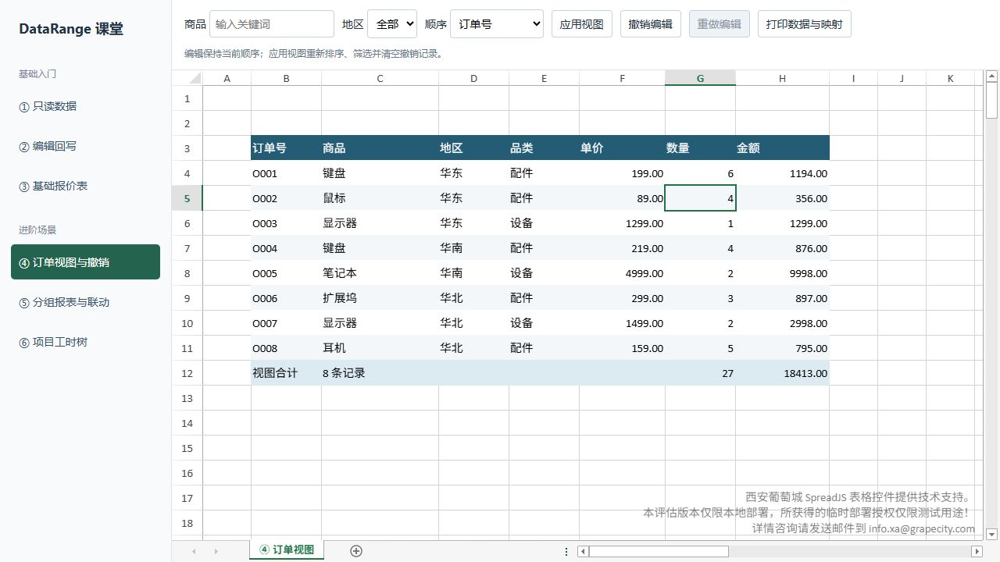

# DataRange 原生撤销与重做验证

日期：2026-11-23。SpreadJS 19.2.3，Windows，Codex 内置浏览器，本机 5186 端口。

## 实现

依据用户指定的[官方数据区域文档](https://demo.grapecity.com.cn/spreadjs/help/docs/features/core-concept/worksheet/worksheet-data-range)，第四课现使用：

- `allowUndo: true`。
- `setValue(row, col, value, changes)` 在赋值前向 changes 记录 `{ type, id, field, oldValue }`。
- 提供者 `undo(change)` 按记录恢复业务对象。
- 页面按钮调用 `spread.undoManager().undo()` / `.redo()`。
- 按钮状态读取 `canUndo()` / `canRedo()`；不再使用自定义 past / future。
- 编辑期间只重算合计并重绘，保持显示行映射稳定。
- “应用视图”提交当前编辑、清空原生历史，再重建筛选排序布局。

## 浏览器实测

1. 金额降序后首条 O005 数量从 2 改为 0：它保留在当前行，总金额从 17528.00 变为 7530.00。
2. 页面撤销恢复数量 2、金额 9998.00、总金额 17528.00；Console 出现 provider.undo 日志。
3. 页面重做恢复数量 0、金额 0.00、总金额 7530.00；Console 再次出现 setValue 日志。
4. 表格有焦点时，Ctrl+Z 与 Ctrl+Y 得到相同的撤销、重做结果，按钮状态同步更新。
5. 撤销后新编辑单价为 5000：数量 2、金额 10000.00，总金额 17530.00；旧的重做分支被清除。
6. 应用华东筛选后，显示 3 条、合计 1964.00，两个历史按钮均不可用。旧编辑不能重放到新布局。
7. 初始视图连续修改 O001 数量 2→6、O002 数量 3→4：合计 18413.00。
8. 连续撤销两次：两条数量恢复 2 和 3，合计恢复 17528.00。
9. 连续重做两次：数量再次为 6 和 4，合计再次为 18413.00。
10. 浏览器 error 日志为空；最后刷新恢复初始数据和空历史。

## 其他检查及范围

原先的 RecordHistory 类及对应业务历史测试已移除。剩余 5 项纯业务测试全部通过；04-orders.js 语法检查通过。

前一轮 MIME 白屏也已修复：共享浏览器模块改为 `business-model.js`，5186 返回 `200 text/javascript; charset=utf-8`，第四至六课均已在该端口正常加载。

本次验证覆盖原生单格编辑命令；批量粘贴、清除、结构增删和跨布局历史不在此次保证范围。第五、六课仍关闭撤销。将“应用视图”作为清栈边界是本教学案例的应用选择，并非官方对所有 DataRange 的要求。
